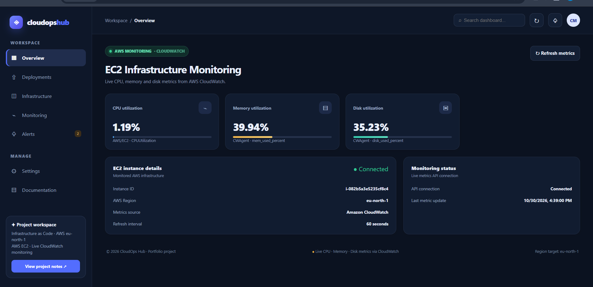

# CloudOps Hub – AWS Infrastructure Monitoring Dashboard

CloudOps Hub is an AWS infrastructure monitoring dashboard that retrieves CPU, memory, and disk utilization metrics from Amazon CloudWatch and displays them through a web-based dashboard.

The project demonstrates AWS monitoring, IAM role-based access, Python API development, Docker containerization, and deployment on an EC2 instance.

## Dashboard Preview



## Features

- Monitor AWS EC2 infrastructure.
- Retrieve CPU utilization from Amazon CloudWatch.
- Retrieve memory and disk utilization through CloudWatch Agent.
- Display live metrics through a web dashboard.
- Flask API for CloudWatch metric retrieval.
- Nginx reverse proxy and static dashboard hosting.
- Automatic dashboard refresh every 60 seconds.
- Docker-based application deployment.
- IAM role-based AWS access without hardcoded credentials.

## Architecture

```text
                 AWS EC2 Instance
                        |
                 IAM Instance Role
                        |
                 Amazon CloudWatch
                   /          \
             AWS/EC2          CWAgent
               CPU          Memory / Disk
                   \          /
                    Flask API
                        |
                  Gunicorn Server
                        |
                   Nginx Proxy
                        |
                 Web Dashboard
                        |
                     Browser
```

## Technology Stack

| Category | Technologies |
|---|---|
| Cloud | AWS EC2, CloudWatch, IAM |
| Monitoring | CloudWatch Agent |
| Backend | Python, Flask, Gunicorn |
| Web Server | Nginx |
| Containerization | Docker, Docker Compose |
| Infrastructure as Code | Terraform |
| Version Control | Git, GitHub |
| CI | GitHub Actions |

## Project Structure

```text
cloudops-hub/
├── api/
│   ├── app.py
│   └── requirements.txt
├── app/
│   ├── Dockerfile
│   ├── index.html
│   └── nginx.conf
├── screenshots/
│   └── dashboard-overview.png
├── .github/
│   └── workflows/
│       └── ci.yml
├── docker-compose.yml
├── .gitignore
└── README.md
```

## CloudWatch Monitoring

The application retrieves the following metrics:

| Metric | CloudWatch Namespace | Metric Name |
|---|---|---|
| CPU utilization | AWS/EC2 | CPUUtilization |
| Memory utilization | CWAgent | mem_used_percent |
| Disk utilization | CWAgent | disk_used_percent |

**Monitoring configuration:**
- Metrics retrieval window: Last 3 hours.
- CloudWatch data period: 5 minutes.
- Dashboard refresh interval: 60 seconds.

The dashboard displays the latest available CloudWatch datapoints, not instantaneous measurements.

## API Endpoints

| Endpoint | Description |
|---|---|
| `/api/health` | Checks API health |
| `/api/metrics` | Retrieves CPU, memory, and disk metrics |

## Run the Application

Clone the repository:

```bash
git clone https://github.com/chitra2702/cloudops-hub.git
cd cloudops-hub
```

Build and start the application:

```bash
docker compose up -d --build
```

Access the dashboard:

```text
http://localhost:8080
```

Check the API:

```bash
curl http://localhost:8080/api/health
curl http://localhost:8080/api/metrics
```

## AWS Configuration

The application uses an EC2 IAM instance role to retrieve CloudWatch metrics through Boto3.

Required configuration includes:

- An EC2 instance with an attached IAM role.
- Appropriate CloudWatch read permissions.
- CloudWatch Agent configured to publish memory and disk metrics.
- Correct AWS region and EC2 instance ID in the API configuration.

No AWS access keys are hardcoded in the application.

## Docker Hub

Docker image:

https://hub.docker.com/r/chitramanam/cloudops-hub

## Key Learnings

Through this project, I gained practical experience with:

- Deploying containerized applications on AWS EC2.
- Configuring IAM roles and permissions.
- Collecting infrastructure metrics using Amazon CloudWatch.
- Configuring CloudWatch Agent for memory and disk monitoring.
- Building REST APIs using Python Flask.
- Configuring Nginx as a reverse proxy.
- Building and running applications using Docker Compose.
- Integrating AWS services with a web-based monitoring dashboard.

---

**Project:** CloudOps Hub
**Focus:** AWS Cloud Monitoring | DevOps | Docker | Infrastructure Monitoring
